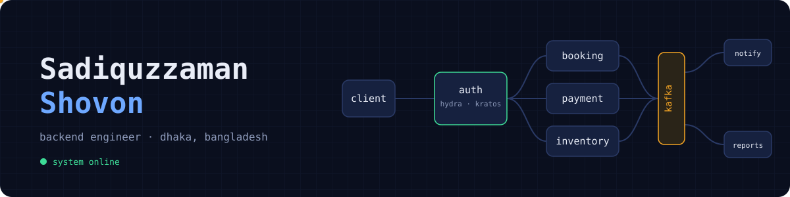
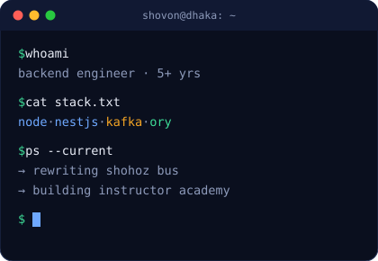

  

<h1 align="center">Hi 👋, I'm Sadiquzzaman Shovon</h1>
<h3 align="center">Backend Software Engineer @ Shohoz Limited</h3>

  

Building reliable backend systems with clean architecture and scalable design.

---

<h2 align="center">🚀 About Me</h2>

<table>
<tr>
<td width="58%" valign="top">

**Shovon** here, a backend engineer from Dhaka with **5+ years** shipping production systems in travel, fintech and AI commerce.

At **Shohoz** I'm rewriting **Shohoz Bus** from a legacy system, using **Ory Hydra & Kratos** for identity and OAuth2 and **Apache Kafka** for event-driven services. Before that, I built airline integrations that serve **10M requests/day** and raised ticket purchases by **500%**.

I'm also co-founder of **Instructor Academy**, an exam proctoring and academic management platform for schools, coaching centres and teachers.

I like systems that are simple to reason about, fast under load, and easy to change.

</td>
<td width="42%" align="center" valign="middle">
  
</td>
</tr>
</table>

<h2 align="center">🤝 Connect</h2>

  &nbsp;
  &nbsp;
  &nbsp;
  

<h2 align="center">💻 Tech Stack</h2>

  

  
  
  

<h2 align="center">⭐ Featured Work</h2>

| Project | What I built | Impact |
|---|---|---|
| **Shohoz Bus rewrite** | Legacy-to-modern rebuild with Ory Hydra/Kratos identity and Kafka events | In progress |
| **Instructor Academy** | Co-founder; proctoring + academic management SaaS | Schools, coaching centres, teachers |
| **Shohoz Air** | BDFare & US-Bangla integrations; flight search and booking backend | **+500%** purchases · 10M req/day |
| **Orderbutler.ai** | Serverless backend for an agentic AI commerce chatbot | Onboarded one of Sweden's largest suppliers |
| **iCaddie** | AI golf assistant with A* shot pathfinding and RAG | Secured product funding |
| **bKash Loan Event Stream** | Event-driven loan eligibility engine | **1k+ events/min** |

<h2 align="center">📊 GitHub Stats</h2>

  

<h2 align="center">📈 Activity Graph</h2>

  

